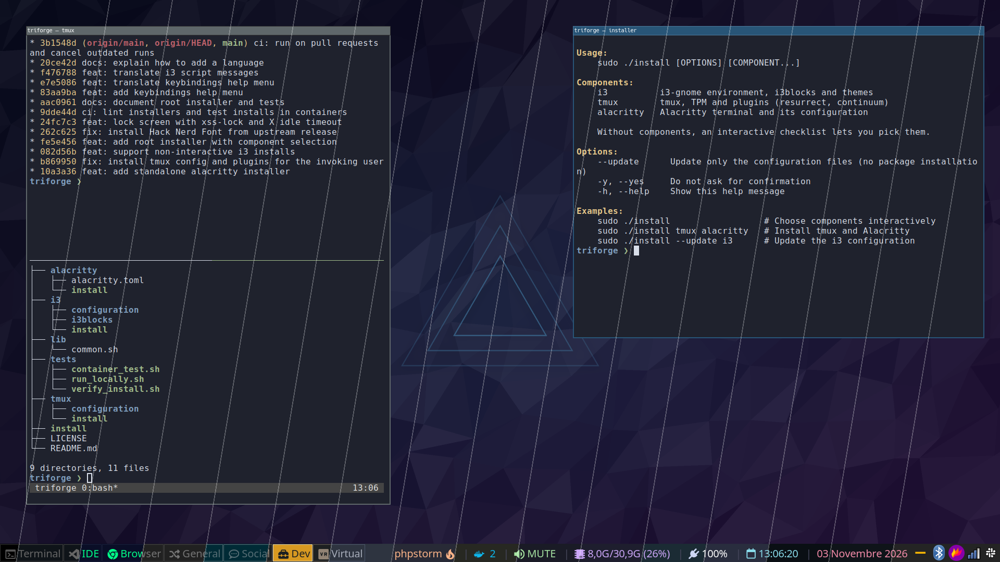
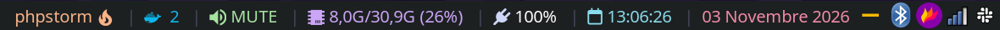
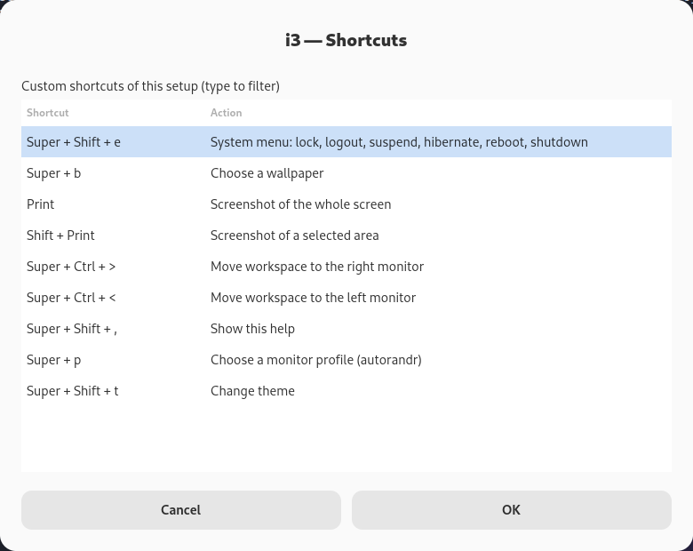
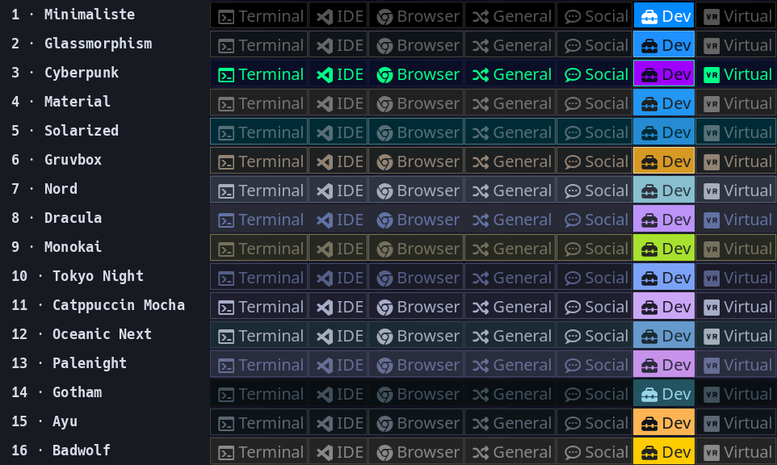

<p align="center"></p>

<h1 align="center">triforge</h1>

[](https://github.com/nmetahri/triforge/actions/workflows/ci.yml)

An opinionated setup for Debian/Ubuntu-based systems, made of three independent components:

| Component | What it installs |
|---|---|
| `i3` | i3-gnome environment: packages, `i3blocks`, Hack Nerd Font, themes and configuration |
| `tmux` | tmux, TPM and plugins (resurrect, continuum, sensible) |
| `alacritty` | Alacritty terminal and its configuration |


<sub>One desktop, sixteen themes: each slanted strip is the same screen captured with a different theme.</sub>

## How to install ?

### One-line install

```bash
bash -c "$(curl -fsSL https://raw.githubusercontent.com/nmetahri/triforge/main/bootstrap)"
```

Run it as your regular user, not with `sudo`: it asks for your password when needed. It installs `git` if
missing, clones triforge into `~/.local/share/triforge` (or updates it), then runs the installer below.
Pass installer arguments after `--`:

```bash
bash -c "$(curl -fsSL https://raw.githubusercontent.com/nmetahri/triforge/main/bootstrap)" -- tmux alacritty
```

To update an existing installation, run it again with `--update`: it pulls the latest version first, then
copies the configuration files without reinstalling packages (add component names to skip the checklist):

```bash
bash -c "$(curl -fsSL https://raw.githubusercontent.com/nmetahri/triforge/main/bootstrap)" -- --update
```

As with any script piped from the internet, you can [read it](bootstrap) before running it.

### From a clone

Clone the repository and run the installer from its root:

```bash
git clone https://github.com/nmetahri/triforge.git
cd triforge
sudo ./install
```

Without arguments, a checklist lets you pick the components. You can also name them directly:

```bash
sudo ./install tmux alacritty     # install only tmux and Alacritty
sudo ./install --update           # pick components, then update their configuration only
sudo ./install --update i3        # update the i3 configuration after a git pull
sudo ./install --yes i3 tmux      # no confirmation prompts
sudo ./install --help
```

Configuration files are always installed in the home directory of the user who ran `sudo`.
Each component can also be installed on its own with its `install` script (e.g. `sudo ./tmux/install`).

After installing `i3`, reboot and select the `i3+gnome` session at the login screen.

## External Dependencies

This setup builds and installs from the following external projects:

- **i3blocks** (https://github.com/vivien/i3blocks, GPL-3.0) — Status bar for i3. Debian/Ubuntu only package the
  older 1.4 release, so the installer builds it from source, pinned to a known `master` commit (`I3BLOCKS_COMMIT`
  in `i3/install`).
- **i3-gnome** (https://github.com/i3-gnome/i3-gnome, MIT) — GNOME session integration for i3. The project is
  archived, so its session files are vendored in [`i3/i3-gnome`](i3/i3-gnome) and installed from there.

**Hack Nerd Font** (https://github.com/ryanoasis/nerd-fonts) is not packaged by Debian/Ubuntu: the i3 installer downloads a pinned release into `/usr/local/share/fonts`.

The tmux setup uses [TPM](https://github.com/tmux-plugins/tpm) to install its plugins, including
**tmux-resurrect** from a maintained fork (https://github.com/nmetahri/tmux-resurrect) that bundles
fixes still unmerged upstream (e.g. panes restored to `$HOME` when their title is empty).

## Status Bar



The i3 bar runs [i3blocks](https://github.com/vivien/i3blocks) with custom scripts (`i3/i3blocks/scripts`), from left to right:

| Block | Shows |
|---|---|
| `top_process` | The process using the most resources (CPU + memory) |
| `docker` | Number of running Docker containers, highlighted when some are running |
| `volume` | Output volume, or `MUTE` |
| `memory` | Used / total memory and its percentage |
| `battery2` | Battery level and charging state |
| `calendar` | Current time; click to open a calendar |
| `time` | Current date, in your locale |

## Some commands to know for my i3-gnome environment
`$mod` Refers to the modifier key (super by default)

### General
* `$mod+<Enter>` Open a terminal
* `$mod+d` Open dmenu (text based program launcher)
* `$mod+r` Resize mode (<Esc> or <Enter> to leave resize mode)
* `$mod+shift+r` Restart i3 in place
* `$mod+shift+c` Reload config file
* `$mod+shift+q` Kill window (does normal close if application supports it)

### Windows
* `$mod+w` Tabbed layout
* `$mod+e` Vertical and horizontal layout (switches to and between them)
* `$mod+s` Stacked layout
* `$mod+f` Fullscreen

### Moving Windows
* `$mod+shift+<direction key>` Move window in _direction_ (depends on direction keys settings)
* `$mod+Ctrl+greater` Move window to right output screen
* `$mod+Ctrl+less` Move window to left output screen 

### Brightness keys
* `XF86MonBrightnessUp` Increase brightness
* `XF86MonBrightnessDown` Decrease brightness

### Media keys
* `XF86AudioPlay` Play/Pause
* `XF86AudioPause` Pause/Pause
* `XF86AudioNext` Next
* `XF86AudioPrev` Previous

### Custom key bindings
Press `$mod+Shift+,` (`$mod+?` on AZERTY keyboards) to open a searchable list of these shortcuts.
To add a shortcut to that list, put a `# help: <English description>` comment right above its `bindsym`,
optionally followed by translations (`# help-fr: <description en français>`). The menu uses your locale and
falls back to English.



* `$mod+Shift+e` Open system menu : (l) lock, (e) logout, (s) suspend, (h) hibernate, (r) reboot, (Shift+s) shutdown
* `$mod + p` — Open monitor layout selector (`select_xrandr_profile.bash`, lists autorandr profiles)
  (see [Monitor Profiles](#monitor-profiles-autorandr))
* `$mod+Shift+t` Open theme selector (dmenu with available themes)
* `$mod+b` Choose a background image
* `shift+Print` Take a screenshot on selected area
* `Print` Take a full window screenshot
* `$mod+Ctrl+>` / `$mod+Ctrl+<` Move the focused workspace to the right / left monitor
* `$mod+Shift+,` Show the shortcuts help menu

## Monitor Profiles (autorandr)

Monitor layouts are handled by [autorandr](https://github.com/phillipberndt/autorandr). Each profile stores
an `xrandr` layout plus the fingerprint of the connected screens, so the right layout is picked automatically.
Profiles are machine-specific, so they are **not versioned**: create them on each machine.

### Create a profile
1. Plug in your monitors and arrange them (with `xrandr`, or a GUI such as `arandr`)
2. Save the current layout: `autorandr --save <name>` (e.g. `office`, `home`, `laptop`)
3. Repeat for every setup you use

Profiles are stored in `~/.config/autorandr/<name>/`.

### Use profiles
* At i3 startup, `autorandr --change` loads the profile matching the connected screens
* `$mod + p` opens a dmenu list of your profiles to switch manually
* `autorandr --list` lists profiles, `autorandr --load <name>` loads one from a terminal

### Run something after each switch
autorandr runs `~/.config/autorandr/postswitch` (if executable) after loading a profile. Restarting i3 there
re-applies the workspace-to-output assignments from `workspaces.conf`:

```bash
#!/bin/bash
sleep 1
[ -f ~/.last_wallpaper ] && feh --bg-scale "$(cat ~/.last_wallpaper)" &
i3-msg restart &
```

Workspaces are pinned to outputs in `workspaces.conf` (`DP-1`, `HDMI-1`, then `eDP-1` as fallback).
Adjust these names to your hardware: `xrandr --query` lists them.

## Languages

Menus and messages from the i3 scripts (theme and monitor selectors, wallpaper picker, shortcuts help...)
follow your locale (`LC_ALL`, `LC_MESSAGES` or `LANG`). English and French are available, and English is
used when a translation is missing. To add a language, copy `i3/configuration/locales/en.sh` to
`locales/<code>.sh` (e.g. `de.sh`) and translate its values.

## Theme System

This setup includes a dynamic theme switching system that allows you to easily change color schemes.

### Available Themes
Themes recolor the i3 bar (background, workspace buttons, focused workspace):



1. **Minimaliste** - Clean and minimal color palette
2. **Glassmorphism** - Modern frosted glass aesthetic
3. **Cyberpunk** - Neon-inspired dark theme
4. **Material** - Google Material Design colors
5. **Solarized** - The popular Solarized dark theme
6. **Gruvbox** - Warm, retro-inspired colors
7. **Nord** - Arctic, north-bluish palette
8. **Dracula** - Dark theme with vivid purple and pink accents
9. **Monokai** - Classic high-contrast editor colors
10. **Tokyo Night** - Deep blue night-city palette
11. **Catppuccin Mocha** - Soothing pastel dark theme
12. **Oceanic Next** - Calm ocean-blue tones
13. **Palenight** - Soft purple Material variant
14. **Gotham** - Very dark, low-contrast blue-green
15. **Ayu** - Minimal dark theme with warm accents
16. **Badwolf** - Dark theme with bright, punchy highlights

### Wallpaper
triforge ships its own wallpaper (`i3/configuration/wallpapers/triforge.png`, a dark low-poly gradient that
suits every theme). It is used until you pick another one with `$mod+b`, which is then remembered.

### How to Switch Themes
Press `$mod+Shift+t` to open the theme selector (dmenu). Choose a theme from the list and it will be immediately applied to:
- i3bar colors and styling
- Window decorations
- All i3 UI elements
- Alacritty terminal colors (automatically synced)

The active theme is managed via a symlink (`colors-active.conf`) that points to the selected theme file. This symlink is automatically created on first installation.

### Adding Custom Themes
To add a custom theme:
1. Create a new `.conf` file in `~/.config/i3/themes/` following this naming pattern: `N-themename.conf` (where N is a number)
2. Define your colors using the following variables:
   ```
   set $bg #1e1e2e
   set $fg #cdd6f4
   set $border-active #89b4fa
   set $border-inactive #45475a
   set $text-urgent #f38ba8
   ```
3. Run `$mod+Shift+t` and select your new theme

## Alacritty Configuration

Alacritty is automatically configured and managed by the installation script.

### Configuration
- Base configuration is located in `~/.config/alacritty/alacritty.toml` (TOML format, Alacritty 0.13+)
- The configuration is synced during installation and updates

### Updating Alacritty Config
When you pull updates from the repository and want to update Alacritty configuration:
```bash
sudo ./install --update alacritty
```

## How to assign an application to a specific workspace ?

In order to assign an application to a specific workspace, you will need to get it's WM class name, to do so, you can save this alias in your bashrc : 

`alias get-window-class="xprop | grep WM_CLASS | awk '{ print \$4 }'"`

When you execute this command, you will have to select a window and it will display its class name, then you can add something like this in your `~/.config/i3/custom.conf` : 

```
assign [class="Firefox"] $ws3
for_window [class="Firefox"] focus
```  

This will always assign Firefox to workspace 3 and focus it when it is launched.

## Testing

Every pull request runs [shellcheck](https://www.shellcheck.net/) and installs each component in fresh
`ubuntu:24.04` and `debian:stable-slim` containers, then checks the result (file ownership, TPM plugins,
valid i3 and Alacritty configuration...). Run the same test locally with Docker:

```bash
tests/run_locally.sh ubuntu:24.04 tmux alacritty
```
